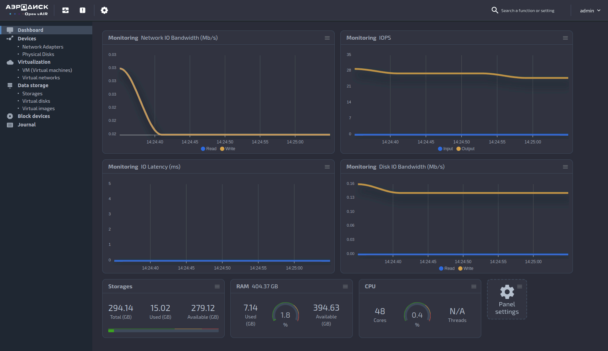

# Open vAIR

## 🌍 Traducciones

- [Русский](README.ru.md)

## 📖 Descripción del Proyecto

**Open vAIR** es una solución ligera basada en el proyecto **vAIR**,
diseñada para su uso como entorno de desarrollo y sistema de virtualización. El
programa opera en modo interactivo, proporcionando una herramienta flexible y
práctica para gestionar la infraestructura virtual.




---

<h3 align="left">Tecnologías:</h3>
<p align="left"> <a href="https://www.docker.com/" target="_blank" rel="noreferrer">  </a> <a href="https://www.linux.org/" target="_blank" rel="noreferrer">  </a> <a href="https://www.postgresql.org" target="_blank" rel="noreferrer">  </a> <a href="https://www.python.org" target="_blank" rel="noreferrer">  </a> <a href="https://www.rabbitmq.com" target="_blank" rel="noreferrer">  </a> <a href="https://fastapi.tiangolo.com/" target="_blank" rel="noreferrer"> </a><a href="https://www.qemu.org/" target="_blank" rel="noreferrer">  </a></p>

---

## 📦 Instalación

Para instalar **Open vAIR** en un sistema Linux limpio, siga estos pasos. Se
recomienda utilizar **Ubuntu 20.04**, que es la versión más probada.
**Ubuntu 22.04** también es compatible.

### ☑️ Preparación para la instalación del proyecto

1. Asegúrese de que todos los paquetes del sistema estén actualizados. Ejecute los siguientes comandos:

    ```shell
    sudo apt update && sudo apt upgrade -y
    ```
    > **Importante**: No olvide reiniciar el sistema después de ejecutar estos
    comandos para aplicar todos los cambios.

2. Ejecute los siguientes comandos para crear y configurar un usuario:

    1. Cree un usuario:

        ```shell
        sudo useradd -s /bin/bash -d /opt/aero -m aero
        ```

    2. Asigne los permisos necesarios:

        ```shell
        sudo chmod +x /opt/aero
        ```

    3. Agregue el usuario a la lista de superusuarios:

        ```shell
        echo "aero ALL=(ALL) NOPASSWD: ALL" | sudo tee /etc/sudoers.d/aero
        ```

    4. Cambie al nuevo usuario:

        ```shell
        sudo -u aero -i
        ```

3. Descargue el repositorio del proyecto:

    ```shell
    # GitHub
    git clone https://github.com/Aerodisk/openvair.git

    # GitFlic
    git clone https://gitflic.ru/project/aerodisk_open_vair/openvair.git

    # GitVerse
    git clone https://gitverse.ru/Aerodisk/openvair.git

    # GitLab
    git clone https://git.aerodisk.ru/openvair/openvair.git
    ```

4. Configure el archivo de configuración:

    ```shell
    nano ~/openvair/project_config.toml
    ```

### ⚙️ Configuración del proyecto

Antes de instalar **Open vAIR**, debe establecer el login y la contraseña en
el archivo `/opt/aero/openvair/project_config.toml`. Estos datos son necesarios
para la autorización del sistema y el acceso a todas las funciones de la aplicación.

Ejemplo de configuración:

```toml
[default_user]
login = ''
password = ''
```

Nota: Los campos de login y contraseña deben ser completados por el usuario. De
lo contrario, la instalación se abortará.

### 🌀 Túnel de la aplicación
Si es necesario ejecutar la aplicación en un host separado como servidor, configure
el túnel hacia la red virtual. Determine la dirección IP local del host
ejecutando el comando:

```bash
ip a
```

Especifique la dirección IP obtenida en el archivo de configuración:

```toml
[web_app]
host = '192.168.1.2'
port = 8000
```

### 🚀 Inicio de la instalación
1. Ejecute el script de instalación:
```bash
./openvair/install.sh
```

Al finalizar la instalación, recibirá un mensaje con la
dirección actual de la aplicación, el login y la contraseña para trabajar con el sistema.

### 🗑️ Desinstalación
Para eliminar Open vAIR, ejecute el script de desinstalación:
```bash
./openvair/uninstall.sh
```

### 📚 Documentación
La documentación se puede encontrar en el archivo `/docs/build/index.html`, el cual se
creará después de la instalación del proyecto. La documentación también estará
disponible en el endpoint `/docs/` una vez que la instalación haya terminado.

### 😈 Daemons

#### Daemon *web-app*
El daemon web-app garantiza el inicio y reinicio automático de la aplicación principal basada en FastAPI,
que es responsable de las operaciones de API y GUI. La
aplicación es accesible en la dirección especificada en la sección web_app del
archivo config.toml. Por defecto, esta es  `http://127.0.0.1:8000`.

* Verificar el estado del daemon:
```bash
sudo systemctl status web-app.service
```
* Reiniciar el daemon:
```bash
sudo systemctl restart web-app.service
```
* Detener el daemon:
```bash
sudo systemctl stop web-app.service
```
* Ver los registros (logs) del daemon:
```bash
sudo journalctl -fu web-app.service
```

#### Daemon *service-layer*
Los daemons de service-layer realizan llamadas a funciones remotas de la capa de servicio.
Cada módulo tiene su propio daemon service-layer. Para verificar el estado y ver
los registros, utilice comandos similares, cambiando el nombre del servicio a
`<module_name>-service-layer.service`.

Por ejemplo:
```bash
sudo systemctl status storage-service-layer.service
```

#### Daemon *domain*
Los daemons de domain realizan llamadas a funciones remotas de la capa de dominio. Cada
módulo tiene su propio daemon domain. Para verificar el estado y ver
los registros, utilice comandos similares, cambiando el nombre del servicio a
`<module_name>-domain.service`.
```bash
sudo systemctl status storage-domain.service
```

### 🔗 Enlaces de documentación
* Introducción al proyecto: [on-boarding](ONBOARDING.md).
* Cómo contribuir al proyecto:  [howto-contribute](CONTRIBUTING.md).
* Código de conducta: [code-of-conduct](CODE_OF_CONDUCT.md).
* Convención de código: [code-convention](CODE_CONVENTION.md).

### 🔗 Frontend del proyecto
* Para trabajar con la interfaz de usuario (Frontend), utilice el repositorio [Open vAIR UI](https://github.com/Aerodisk/Open-vAIR-UI).

### 🔗 Documentación del proyecto
* Para trabajar con la documentación, utilice el repositorio [Open vAIR docs](https://github.com/Aerodisk/Open-vAIR-docs).

### 🔗 Enlaces útiles
* [Canal de Telegram](https://t.me/Open_vAIR_AERODISK)
* [Sitio web de Open vAIR](https://openvair.ru/)

### Estadísticas (incluyendo proyectos de documentación y frontend)
<p></p> <p>&nbsp;</p>

---

### Contribución
Instrucciones para contribuir al proyecto:

1. Cree un fork del repositorio
2. Cree una nueva rama (git checkout -b feature/your-feature)
3. Realice cambios y haga commit (git commit -m 'Added new feature')
4. Publique los cambios (git push origin feature/your-feature)
5. Cree una Pull Request
